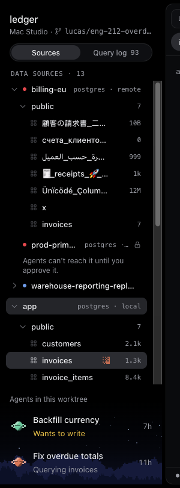
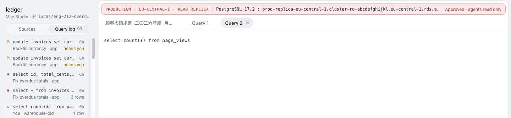
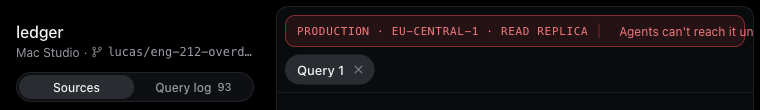
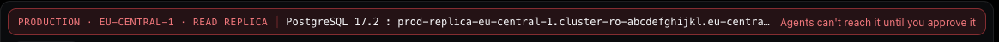
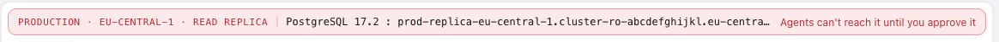
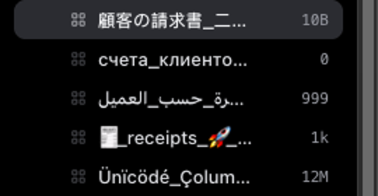
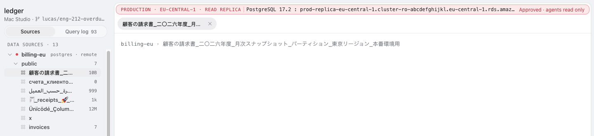
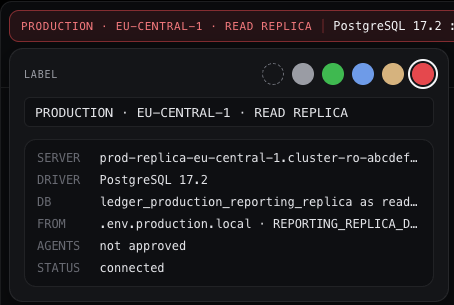

# Adversarial review: U0 + U1, Data mode, sidebar and connection bar (ENG-644)

Reviewed: `17d302f8` (U1, merged in `5dd10174` on `polaris/grill-with-docs-i-want-to-do-7ce3`) and
U0's shell under it (`70c4fa4c`). Rechecked against the integration head `78ba90c0` (DF): DF changes
no Desktop file, and the Daemon rule behind F5 is unchanged there. Read against DESIGN.md → Data,
`.agents/skills/product-design` (rules.md, resilience.md), CONTEXT.md → Data and U1's 48
screenshots; Paper D1–D3 not opened. Reviewer: RU1, Opus 5.5, 2026-10-30. No product code changed.

Rendered in Electron (`--use-mock-keychain`, 1440×900 and the 760×600 minimum window) through the
fixture Layer with scratch scenes. The data was 13 Data Sources and seven tables whose names are
60 characters of Japanese, Cyrillic, Arabic, ZWJ emoji, accented Latin, plus one single letter. It
also had a 40-character red label on an approved and an unapproved remote, a 400-table schema, a
parametrised Query Log entry and one whose source is gone. Screenshots are in
[`2026-10-30-data-U1/`](2026-10-30-data-U1/).

**Verdict.** The shell holds up under load and the worst-case text. ⌥4 paints the 400-table tree
in 16 ms median, the heap stays flat, Reduce Motion stills the dither, and every long or non-Latin
name truncates in its lane. The correctness asks in the brief are where it breaks:

- A label edit is lost on Escape. Any snapshot that lands while the user types also wipes the
  text, and opening the card itself causes one (F1).
- The schema tree is read once and never again (F2).
- A Query Log re-run drops its params (F3). When the entry's source is gone, the bar names a
  different database (F4).
- "Add data source" fails any name with a space or non-ASCII, and the error says "No data source by
  that name" (F5).

The password is never shown or read back, but it sits in the DOM's `value` attribute while typed
(F9).

## Findings

| # | Sev | Where | Finding | Status |
|---|---|---|---|---|
| F1 | P1 | `ui/connection/ConnectionCard.tsx:47`, `:95-99` | Label edits are lost on Escape, and any sources snapshot resets the field mid-typing (the card's own refresh sends one) | CONFIRMED |
| F2 | P1 | `ui/sidebar/useSchemaTrees.ts:38-41` | Each source's schema is read once per mount and kept: refresh, focus and a changed source never re-read it, and a failed read never retries | CONFIRMED |
| F3 | P1 | `ui/sidebar/QueryLogView.tsx:155`, `model/tabs.ts:15-21` | Re-running a Query Log row drops `params`: the SQL tab gets `$1`, `$2` with nothing bound | CONFIRMED |
| F4 | P1 | `ui/ConnectionBar.tsx:18` | A tab whose source isn't listed shows the first source's bar (a red PRODUCTION replica for a query on a missing database) | CONFIRMED |
| F5 | P1 | `ui/sidebar/SourceForm.tsx:62-71` ↔ `apps/daemon/src/data/sources.ts:204` | The form accepts names the Daemon rejects (spaces, non-ASCII, a leading `-`), and the error reads "No data source by that name in this checkout." | CONFIRMED |
| F6 | P2 | `ui/ConnectionBar.tsx:22`, `:60-66` | At the 760px minimum window the bar clips the agents' access, the one fact it must keep | CONFIRMED |
| F7 | P2 | `ui/ConnectionBar.tsx:90` | The access words take the label colour; rule/data-source-label colours only the kicker and never approval state | CONFIRMED |
| F8 | P2 | `ui/connection/ConnectionCard.tsx:95`, `ui/sidebar/SourceForm.tsx:163` | Uppercasing in `onChange` moves the caret to the end on every keystroke typed mid-label | CONFIRMED |
| F9 | P2 | `ui/sidebar/SourceForm.tsx:151-156` | The typed password is mirrored into the input's `value` attribute, so `outerHTML` carries it | CONFIRMED |
| F10 | P2 | `ui/sidebar/SourcesView.tsx:120`, `TreeRow.tsx:62,113,170,182` | `role="tree"` without arrow keys: every row is a tab stop, 400+ before the connection bar | CONFIRMED |
| F11 | P2 | `ui/TabStrip.tsx:21` (U0) | Unselected tabs are `tabIndex={-1}` with no arrow keys: only the active Data tab is reachable by keyboard | CONFIRMED |
| F12 | P3 | `ui/sidebar/TreeRow.tsx:84`, `:136` | Arabic and Hebrew names truncate from their end, not their start (no `dir="auto"`) | CONFIRMED |
| F13 | P3 | `ui/sidebar/QueryLogView.tsx:49` | An "outside Polaris" row's byline drops its Data Source and Turn | CONFIRMED (by reading) |
| F14 | P3 | `model/sidebar.ts:39-45` | The source form is one global store, not per Agent Session | PLAUSIBLE |
| F15 | P3 | `src/shared/keymap.ts:723` (U0) ↔ DESIGN.md → Data | The mode key is ⌥4; DESIGN.md, Paper and U0's commit say ⌘4, and "Open in Data ⌘4" copy will follow DESIGN.md | CONFIRMED (by reading) |
| F16 | P3 | `ui/sidebar/SourceForm.tsx`, `ui/connection/ConnectionCard.tsx` | No way to clear a saved password or remove a manual source, though `passwordAction: "clear"` and `data.source.remove` exist | CONFIRMED (by reading) |

Paths are under `apps/desktop/src/renderer/features/data/` unless given in full.

### F1 · P1 · Label edits are lost on Escape and wiped by any snapshot

`useLabel` keeps the field in local state and posts on a swatch, Enter or blur. Two holes:

- **Escape.** Radix closes the popover and unmounts the field without a blur, so nothing posts.
  Repro P1: open the card on `billing-eu`, type `STAGING-ESC`, press Escape. The kicker still reads
  the old label, and the fixture's `labelSource` was never called. Clicking outside does post
  (`label billing-eu {"text":"STAGING-OUT",…}`): Escape, the usual way to leave a popover, is the
  one that drops the edit.
- **Snapshot reset.** `useEffect(() => setLabel(source.label), [source.label])` runs on every new
  snapshot, because each one from IPC decodes fresh objects. Opening the card calls
  `refreshSources(at)`, which re-subscribes, so the fresh snapshot lands while the user types.
  Repro P2 (snapshots arrive 400 ms after subscribe, as from a remote Host): open the card on `app`
  and type `PRO` at once. The field reads `PROLOCAL`, then `LOCAL` 800 ms later. Any other source
  change (another source's reachability, an agent's Query) does the same.

Fix: post on close (`onOpenChange(false)` flushes the draft). Keep a `dirty` flag, and only take
`source.label` into the field when it isn't dirty or when the label changes by value (compare
`text` and `colour`, not identity). Add a test for each.

### F2 · P1 · The schema tree is read once and kept

`useSchemaTrees` adds each source name to `asked` and never removes it. Nothing re-reads a
schema: not the window-focus refresh, not opening the card, not a source whose host or database
changed under the same name.

Failing scenario (repro P3): `app`'s schema starts as the ledger tables. The fixture then switches
`app` to a schema with only `new_table_after_relist`. Window focus re-subscribes the sources watch,
and the call log shows `watchSources` again. But `describe app` was called exactly once, and the
tree still lists `customers, invoices, invoice_items, payments, currencies`.

In the product, that means:
- A migration an agent ran this Turn doesn't show its new table until the user leaves Data and
  comes back. DESIGN.md's "A" letter for an added table can't land on a row that isn't there.
- A `.env` edit that points `DATABASE_URL` from local to staging keeps the local tables under the
  now-remote source. Opening one tables the wrong database.
- One timeout leaves "Couldn't read its schema · …" until remount, with no retry.

Screenshot (after the focus relist, with the old tables still listed):


Fix: key the tree cache on the source's identity and connection (`id`, `host`, `port`,
`database`, `branch`) and drop entries when any of those change. Re-read open trees on the F14
refresh generation, and retry failed reads on the next refresh.

### F3 · P1 · A re-run drops the Query's params

`QueryLogEntry` carries `params` (CF), but `open` calls `openSqlTab(row.entry.sql, row.source, at)`,
and the SQL tab type has no params field.

Failing scenario (repro P4): the row
`select * from invoices where customer_id = $1 and status = $2` with `params: ["c-42", "overdue"]`
opens a SQL tab with that text and nothing bound. Running it fails on Postgres with "there is no
parameter $1", or, if U2 binds nothing, isn't the Query the agent ran.

DESIGN.md says "any row re-runs into a SQL tab". Fix: carry `params` on the SQL tab, show them in
the run bar, and bind them on Run. Alternatively, inline them as literals with a visible note.

### F4 · P1 · The bar falls back to the first source

`shownSource` is `sources.find(name === active.sourceId) ?? sources[0]`. When the tab's source isn't
listed (removed, renamed, or a log row from an older checkout state), the bar names a different
database than the one the tab will run against.

Failing scenario (repro P4): re-run `select count(*) from page_views`, logged against
`warehouse-old`, which no longer exists. The new tab is bound to `warehouse-old`, but the bar
reads `PRODUCTION · EU-CENTRAL-1 · READ REPLICA … Approved · agents read only`, which is
`billing-eu`.


The bar exists to say which database a query hits (rule/data-source-label: "to tell databases apart
at a glance"), so this is the wrong answer to its one question. Fix: fall back to the first source
only when no tab is active. For an active tab whose source is missing, show the tab's source name
with "Not in this checkout" (no colour) and offer to pick a source.

### F5 · P1 · Names the form accepts, the Daemon refuses with the wrong message

`problemOf` checks only that a name is non-blank. The Daemon lowercases it and requires
`^[a-z0-9][a-z0-9._-]*$`, then fails with `E-DATA-UNKNOWN-SOURCE`.

Failing scenario (repro R1, the real `sources()` service):

```
"Billing DB" -> DataError: No data source by that name in this checkout.
"Analytics"  -> saved as "analytics"
"請求書"      -> DataError: No data source by that name in this checkout.
"billing_eu" -> saved as "billing_eu"
"-x"         -> DataError: No data source by that name in this checkout.
```

A user adding their first source gets an error about a lookup they didn't make. The name is
lowercased without a word, so the tree then shows a different name from the one typed.

Fix, both sides:
- **U1:** validate the Daemon's rule in `problemOf` ("Use lowercase letters, digits, `.`, `_` or
  `-`"), or slugify as the user types and show the result.
- **D/X:** a distinct code and message for an invalid name (`E-DATA-SQL` is wrong too). The fix
  text says the rule.

### F6 · P2 · The bar clips the access text at narrow widths

The kicker and the access text are both `shrink-0`; only the mono middle shrinks. With a
40-character label and "Agents can't reach it until you approve it" on a remote source, the
middle reaches zero at the 760px minimum window. The access text is then cut by the panel's edge
with no ellipsis: the agents' access, the fact that changes what the user should do, is the part
lost.


Fix: give the kicker a `max-w` (about 24ch) with truncation and a `title`. Let the access text
shrink to a short form ("Not approved", "Read · writes ask") before it would clip. Any label text
cap belongs in the protocol (`DataSourceLabel.text` is unbounded).

### F7 · P2 · The access words take the label colour

`<Access tone={tone.text}>` paints "Approved · agents read only" or "Agents can't reach it until you
approve it" in the label's colour. rule/data-source-label colours the bar's ground at 12% and the
kicker in full, and says the colour is "never … approval state". On the default red for remotes,
the access state reads as an alarm. On a tan or blue label, access reads in arbitrary colours.



Fix: access text in `text-subtle` (or `text-default` when it needs the user), whatever the label.

### F8 · P2 · The caret jumps to the end in the label fields

Both label inputs set `value` to `e.target.value.toUpperCase()`. When that differs from what the DOM
holds, React writes it back and the caret moves to the end.

Failing scenario (repro P1): in a field holding `staging`, press Home and type `x`; the value is
`XSTAGING` with the caret at 8, and the next `y` gives `XSTAGINGY`. Rewriting `value` during IME
composition (Japanese, Chinese) also breaks the composition in Chromium. That part is PLAUSIBLE: I
didn't drive an IME.

Fix: keep what the user types and uppercase only for display (the field already has CSS
`uppercase`) and when posting.

### F9 · P2 · The password is in the DOM

The password input is controlled, so React mirrors the typed value into the `value` attribute.

Failing scenario (repro P5): type `hunter2-SECRET`. Then
`getAttribute("value") === "hunter2-SECRET"`, and
`document.documentElement.outerHTML.includes("hunter2-SECRET")` is true. It's never read back from
the Host and never shown: that held. But anything that serialises the DOM gets it in clear: a DOM
snapshot in a bug report, devtools, or an agent driving the app through a browser tool.

Fix: an uncontrolled `<input type="password">` read through a ref on submit, cleared on close.

### F10 · P2 · The tree has `role="tree"` but no tree keyboard

Each row is a `<button role="treeitem">` in the tab order, and the arrow keys do nothing.

Failing scenario (repro P6): Tab from the top bar walks every visible table row, then 12 source
rows, then "Add data source", the agents and finally the connection bar. With the 400-table source
open that is 400+ stops, since the virtualizer mounts rows as focus scrolls. ArrowDown on a source
row leaves focus where it was. Screen readers announce a tree and expect arrows.

Fix: roving `tabIndex` (one stop for the tree) with ↑/↓, ←/→ to close and open, and Enter to open
a table, driven from the flat `rows` list the virtualizer already has. Alternatively, drop the
tree roles and keep plain buttons.

The focus ring itself held: the Starlight ring shows on rows and on the bar.

### F11 · P2 · Only the active Data tab is reachable by keyboard (U0)

`TabStrip` gives unselected tabs `tabIndex={-1}`, as a roving tablist should, but implements no
←/→. In the tab order (repro P6) only the active `div[data-tab]` appears, so no other tab can be
reached without the mouse. Fix: ←/→ (and Home and End) move focus and select, as the Editor's tabs
do.

### F12 · P3 · RTL names truncate from the wrong end

`الفواتير_المتأخرة_حسب_العميل` shows as `…رة_حسب_العميل`: the ellipsis eats the start of the name,
so similar Arabic or Hebrew names become indistinguishable.


Fix: `dir="auto"` on the name spans (tree, tab title, bar table).

### F13 · P3 · Outside-Polaris rows lose their source and Turn

`byline` returns `${title} · outside Polaris` for `author.kind === "outside"`. DESIGN.md's Query Log
row has author, Turn, Data Source, SQL, rows and time. For an outside `psql`, which database it hit
is the useful fact. Fix: `title · turn n · source · outside Polaris`, truncating the title first.

### F14 · P3 · The source form isn't per session (PLAUSIBLE)

`formStore` is global, while `Shown` remounts Data per Agent Session. If Data is left while the form
is open (a mode key reaches the window under a modal), it reopens in whichever session Data shows
next. An Edit form then saves the old session's source into the new session's checkout. I didn't
drive this. Fix: key the form by `DataSessionKey`, or close it on unmount.

### F15 · P3 · ⌥4, not ⌘4 (U0)

`"view.data": ["Alt+4"]`, matching the other modes (⌥1–⌥3, with ⌘N for Workspace chips).
DESIGN.md → Data, Paper's page title, U0's commit and the planned "Open in Data ⌘4" copy all say ⌘4.
Fix the docs (DESIGN.md says ⌥4, and copy is built with `formatChord` from KEYMAP, as DESIGN's
Shortcuts rule already requires), not the key.

### F16 · P3 · Manual source management stops at Edit

The protocol has `passwordAction: "keep" | "clear" | "set"` and `data.source.remove`. The form
never sends `passwordAction` (blank keeps, which is right), so a saved password can't be cleared.
And nothing removes a manual source. U1's notDone lists Disconnect and "Agent access…" but not
these. Fix: "Remove saved password" under the field when editing, and Remove in the card for manual
sources.

## What was attacked and held

- **⌥4 with a big schema.** Twenty Orchestrate → Data switches, with the 400-table replica open.
  The time from `setMode("data")` to more than 20 table rows painted (two rAFs) was
  14–20 ms, max 37 ms, median 16. That is inside the < 100 ms budget. The fixture's describe is
  instant, so a real Host adds one IPC round trip before the tree. The virtualizer mounts 28 rows.
- **Memory.** JS heap 13 MB before and 15 MB after the 20 switches (after GC); DOM nodes
  919 → 917. Process working sets: renderer 247 MB, browser 237, GPU 101.
- **Reduce Motion.** The running read's dither on `app.invoices` changes between frames 350 ms
  apart with `no-preference`, and is identical under `reduce`.
- **Worst-case text.** Japanese, Cyrillic, ZWJ emoji, accented Latin, a 1-letter name and 60-char
  names all truncate in the name lane, and the estimate lane stays aligned. That holds for
  `10B`/`0`/`999`/`1k`/`12M`, in both themes and all three densities. The 40-char label fits the
  card's field, and the source name keeps its 6ch beside the lock (F12 aside).
  
  
- **13 Data Sources**, the unapproved and the denied remote (lock plus note, no expansion), an
  unreachable local ("Can't reach localhost:5432 · connection refused"), and zero sources (the
  empty state names what was searched). Reconnecting and Offline dim the sidebar and bar and
  disable Add and Edit. These were checked in U1's 48 screenshots and the code, not reshot.
- **Label persistence.** Clicking outside or pressing Enter posts `data.source.label`. The Daemon
  stores labels per source id, so they survive a restart, including on discovered sources: D's
  `sources.test.ts` "manual sources and labels survive restart …" and the `app` relabel at
  `:145-149`.
- **Password.** Never pre-filled on Edit, sent only when non-empty, `autocomplete=new-password`,
  not in any error. Only the DOM attribute (F9) leaks it.
- **Re-run into the right source** when the source exists: `q-params` opened against `app`, and
  the bar said `app` (F3 and F4 aside).
- **Colour.** The label dot is the only label colour in the tree. Git letters use their tints, and
  needs-you and failed use their state tokens (F7 aside).
- **Glossary copy.** Every string in `features/data/ui` is lowercase on glossary words mid-sentence
  ("data sources", "agent session", "query log", "worktree", "needs you"), per
  rule/glossary-lowercase.
- **⌥4 / Reconnecting copy.** "Mac Studio · Reconnecting" matches the Editor's status bar.

Not attacked: a real Postgres or MySQL behind the sidebar, IME composition (F8), the `-cvd`
palette (Data adds no diff colours), and Paper D1–D3 (compared with U1's screenshots and
DESIGN.md only).

## Repro

The scratch scenes and probe were placed at
`apps/desktop/src/renderer/features/data/preview/rvProbe.ts` (fixtures and a logging,
latency-adding `DataApi`) and `apps/desktop/scripts/rvProbe.ts` (Playwright over Electron, built
like `dataSidebarScreens.ts`), with three `rv-*` scenes added to `SidebarPreview.tsx`. The Daemon
repro was placed at `apps/daemon/src/data/rvrepro.test.ts`. All were removed before commit. Run
with `node scripts/rvProbe.ts --build --out /tmp/rv-u1` from `apps/desktop`, and
`bun test src/data/rvrepro.test.ts` from `apps/daemon`. Output (screenshot lines dropped):

```
rv: escape: kicker PRODUCTION · EU-CENTRAL-1 · READ REPLICA calls [ 'describe billing-eu' ]      # P1
rv: click outside: kicker STAGING-OUT calls [ 'label billing-eu {"text":"STAGING-OUT","colour":"red"}' ]
rv: caret after typing at start { value: 'XSTAGING', caret: 8 }
rv: caret then y { value: 'XSTAGINGY', caret: 9 }
rv: typed before relist lands { value: 'PROLOCAL', caret: 3 }                                       # P2
rv: after relist landed { value: 'LOCAL', caret: 5 }
rv: tables before [ …7 intl…, 'customers', 'invoices', 'invoice_items', 'payments', 'currencies' ] # P3
rv: tables after focus relist [ …same… ]
    calls [ 'watchSources', 'watchSources', 'watchSources', 'describe billing-eu', 'watchSources',
            'watchSources', 'describe app', 'watchSources' ]
rv: q-params sql tab select * from invoices where customer_id = $1 and status = $2 bar app connection   # P4
rv: q-gone sql tab select count(*) from page_views bar billing-eu connection
rv: password value attribute "hunter2-SECRET" in outerHTML true                                    # P5
rv: tab order                                                                                       # P6
  … button[radio] Sources, button[data-source-row] billing-eu, button[treeitem] public,
  7 × button[data-table-row], 12 × button[data-source-row], button[data-add-source],
  2 × div[data-agent], button[data-connection-bar], div[data-tab] (the active one only), …
rv: after ArrowDown on first source row data-source-row (focus unmoved)
rv: dither no-preference frames differ true
rv: dither reduce frames differ false
rv: ⌘4 to 400-table tree painted, ms 14,14,14,14,15,15,15,15,16,16,16,16,18,18,19,19,19,19,20,37 median 16 max 37
rv: heap MB at start 13 nodes 919 / after 20 switches 15 nodes 917
rv: process working sets MB [{"type":"Browser","mb":237},{"type":"GPU","mb":101},{"type":"Utility","mb":47},{"type":"Tab","mb":247}]
R1 "Billing DB" -> DataError: No data source by that name in this checkout.
R1 "Analytics" -> saved as "analytics"
R1 "請求書" -> DataError: No data source by that name in this checkout.
R1 "billing_eu" -> saved as "billing_eu"
R1 "-x" -> DataError: No data source by that name in this checkout.
```

The probe's key pieces:

```ts
// rvProbe.ts (renderer): every relist decodes fresh objects, as IPC does, and lands after `delay`.
const wire = (api: DataApi, delay: number): DataApi => ({ ...api,
  watchSources: (at, on) => { let live = true; rvLog.push("watchSources");
    const inner = api.watchSources(at, { next: (snapshot) => setTimeout(() => { if (live)
      on.next(snapshot.map((s) => Schema.decodeSync(DataSource)(Schema.encodeSync(DataSource)(s)))); }, delay) });
    return () => { live = false; inner(); }; } });
// rv-relist: app's schema switches to `new_table_after_relist` once window.rvSchemaV === 2.

// scripts/rvProbe.ts (Playwright)
await page.getByTestId("data-connection-bar").click();
await page.getByTestId("data-label-field").fill("STAGING-ESC");
await page.keyboard.press("Escape");                                   // P1: kicker unchanged, no label call
await f.fill("staging"); await f.press("Home"); await f.press("x");   // caret → 8
await page.getByTestId("data-connection-bar").click();                 // P2: card refresh, 400 ms snapshot
await f.pressSequentially("PRO", { delay: 30 });                       // 'PROLOCAL' → 'LOCAL'
await page.evaluate(() => { window.rvSchemaV = 2; window.dispatchEvent(new Event("focus")); });  // P3
await form.locator('input[type="password"]').fill("hunter2-SECRET");   // P5
const t0 = performance.now(); rvNav.actions.setMode("data");           // perf: until > 20 table rows + 2 rAF
await page.emulateMedia({ reducedMotion: "reduce" });                  // two row screenshots 350 ms apart
```

```ts
// apps/daemon/src/data/rvrepro.test.ts
for (const name of ["Billing DB", "Analytics", "請求書", "billing_eu", "-x"]) {
  const r = yield* service.save({ sessionId, name, engine: "postgres", host: "db.example.test", port: 5432,
    database: "ledger", user: "", label: { text: "", colour: "red" } }).pipe(Effect.result);
  console.log(`R1 ${JSON.stringify(name)} ->`, r._tag === "Success" ? `saved as ${JSON.stringify(r.success.name)}` : `${r.failure._tag}: ${r.failure.message}`);
}
```
