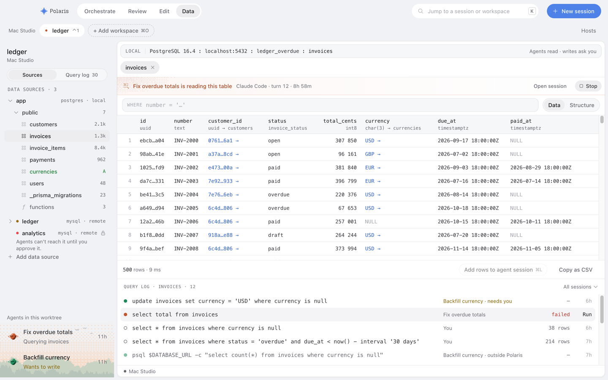
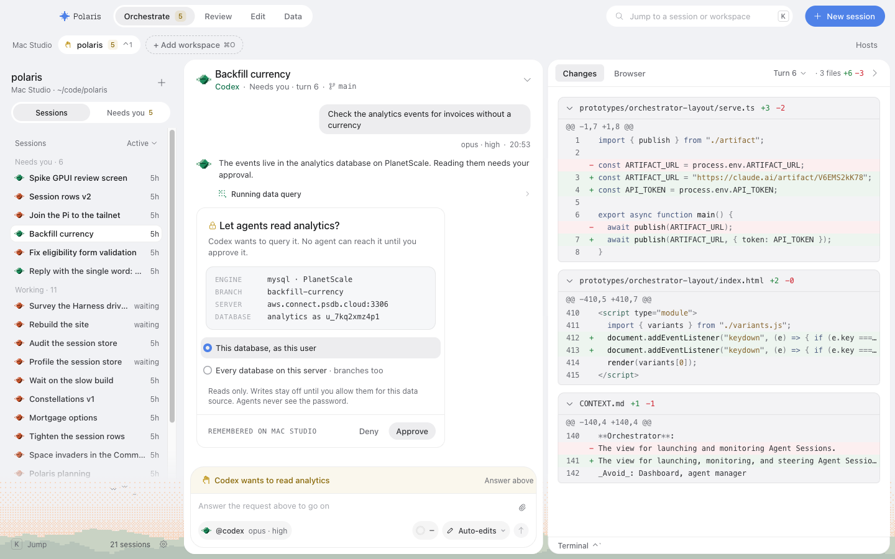

# Adversarial review: U3, SQL tab, Query Log drawer and the Data Source Approval card (ENG-644)

Reviewed: `870078f0` (U3, merged in `8761a489` on `polaris/grill-with-docs-i-want-to-do-7ce3`).
Rechecked against the integration head `d2033702`, which adds X (read-only execution, the Query
Log and Data Source Approvals) and changes no Desktop file. Read against DESIGN.md → Data,
`docs/specs/data-tools-v1.md`, CONTEXT.md → Data, and U3's screenshots. Paper D1–D2 were not
opened. Reviewer: RU3, Opus 5.5, 2026-10-30. No product code changed.

The probes ran in three places, all in a scratch worktree at `d2033702`:

- **Renderer.** `bun test` (happy-dom) on the real `SqlTabBody`, `useCatalog`, the catalog and
  CodeMirror's lang-sql completion, with a recording `DataApi`.
- **Daemon.** X's `DataApprovals` on the real session machine and event store. X's
  `executeRead` against a scratch Postgres 17.
- **Electron.** U3's own screenshot scripts (`dataSqlScreens.ts`, and `sessionScreens.ts
  --scenes data-approval`): 26 frames covering both themes and the three densities. Three of
  them are in [`2026-10-30-data-U3/`](2026-10-30-data-U3/).

**Verdict.** Completion is not the problem. On a 400-table schema it costs 0.01 ms per keystroke
(median) and 2.8 MB of heap. The approval card can't approve a target other than the one it
shows. The run path and the answer paths are where it breaks:

- ⌘↵ sends a new `data.query` on every press and every key repeat while one is already running
  (F1).
- A running query can't be cancelled (F2).
- Answering one of two pending approvals for the same source leaves the other session Needs You,
  while Data says the source is approved (F3).
- ⌘⇧A and the inbox, hover and notification Approve all bypass the card's scope (F4).
- The completion catalog goes stale after a migration and stays stale until restart (F5).
- A Query Log re-run picks its source by name (F6).
- On a real Host no error carries a position, and MySQL's text fallback can't match the
  Daemon's wrapped SQL (F7).

## Findings

| # | Sev | Where | Finding | Status |
|---|---|---|---|---|
| F1 | P1 | `ui/sql/SqlEditor.tsx:78`, `sql/state.ts:88-93` | ⌘↵ runs the query again on every press and key repeat while one is running; ten presses sent ten `data.query` | CONFIRMED |
| F2 | P1 | `data/api.ts:133`, `ui/sql/RunBar.tsx`, `sql/state.ts` | A running query can't be cancelled: no Cancel, no abort on source change or tab close, and the cancellable `data.query.stream` is unused | CONFIRMED |
| F3 | P2 | `approval/PendingDataApproval.tsx`, `ui/connection/ConnectionCard.tsx:103` ↔ X `apps/daemon/src/data/approvalStore.ts` | Two sessions pending on one source: answering one leaves the other Needs You, and Data hides the card while the conversation still asks | CONFIRMED |
| F4 | P2 | `shell/commands.ts:132-141`, `needs-you/respond.ts` (`approve`), `Inbox.tsx:128`, `Hover.tsx:104`, `bridge.ts:41` | ⌘⇧A and the inbox, hover and notification Approve send `Allow{remember:false}` with no `dataScope`: the card's scope is ignored, it is remembered anyway, and ⌘⇧A answers `pendingApprovals[0]`, not the card in view | CONFIRMED |
| F5 | P2 | `sql/useCatalog.ts:32`, `sql/catalog.ts:66` | After a migration, a table's detail read earlier shadows the fresh tree, is never re-read, and lives as long as the app | CONFIRMED |
| F6 | P2 | `ui/QueryLogDrawer.tsx:37`, `sql/state.ts:93` | A Query Log re-run resolves the source by name: a name now used by another source auto-runs there, and a gone source auto-runs anyway | CONFIRMED |
| F7 | P2 | `sql/sqlError.ts:52` ↔ X `apps/daemon/src/data/execution.ts:22-56`, `:157`, `:164` | No real error carries `position`/`sqlLine`. Postgres's position would count the DECLARE prefix. MySQL's wrapper shifts the line and pollutes the `near '…'` text, so `mysqlNear` can't match | CONFIRMED (Postgres), PLAUSIBLE (MySQL) |
| F8 | P2 | `model/working.ts:47`, `:59` | The Working strip says "is reading" after the query has finished, "is changing" for reads that contain `set` or `comment`, and matches a table named in a string literal | CONFIRMED |
| F9 | P3 | `sql/useCatalog.ts:86` | The same table name in two schemas re-sends `describe` after every typing pause | CONFIRMED |
| F10 | P3 | `model/queryLog.ts:246` | The auto-run gate passes reads that act: `pg_terminate_backend` ran in X's read-only transaction and killed another connection | CONFIRMED |
| F11 | P3 | `sql/sqlError.ts:81` | The quoted-name fallback marks the first occurrence, including one inside a string literal | CONFIRMED |
| F12 | P3 | `approval/PendingDataApproval.tsx:33` ↔ `apps/daemon/src/data/connection.ts:116` | Renaming a source while its approval is pending drops the card from Data, since the id hashes the name; the conversation still shows it under the old name | CONFIRMED (by reading) |
| F13 | P3 | `session/ui/rows.tsx` (`DataApproval`), `PendingDataApproval.tsx`, `needs-you/model/popover.ts` | One request reads three ways: "Codex wants to query it" in the conversation, "Backfill currency wants to query it" in Data, and "wants to use a tool" in Needs You | CONFIRMED (by reading) |

Paths are under `apps/desktop/src/renderer/features/data/` unless given in full.

### F1 · P1 · ⌘↵ runs the query again while it runs

The Run button is disabled while a run is `running`. The editor's `Mod-Enter` binding calls
`runSqlTab` directly, and `runSqlTab` checks only for empty text or no source; it never checks
whether a run is in flight. Each call sends a fresh `data.query`. The tab keeps only the last
one's outcome, but every request reaches the Host.

Repro P1: two ⌘↵ presses, then eight key-repeat `keydown`s on `.cm-content`, sent **10**
`data.query` requests while the button read "Running…" and was disabled. Holding ⌘↵ for a second
sends about 30. X's pool allows two connections per source (`pools.ts:15`), and
`executeRead` starts its 30 s timer only after `reserve()`. The extra requests therefore queue
without a time limit, and the agents' queries on the same source wait behind them. Each request
also writes a Query Log row.

Fix: return early from `runSqlTab` (or from the keymap) when the tab's run is `running`, and add
a regression test that holds ⌘↵.

### F2 · P1 · A running query can't be cancelled

The brief asks for cancelling a long query. The SQL tab runs through the unary `api.query`
(`liveDataApi.query` is `polaris().request(...)`, with no abort). Three gaps follow:

- **No control.** The run bar has no Cancel or Stop. Repro P2 found 0 matching buttons while
  running, and Run is disabled until the Host answers.
- **Switching source.** `setSqlSource` resets the tab to idle and drops the outcome, but the
  request keeps running on the Host.
- **Closing the tab.** The request keeps running there too.

The spec gives the Desktop a cancellable path: `data.query.stream` ("renderer unsubscribe …
cancels server work and rolls back/releases it"), and `queryStream` returns a cancel function.
U3's notDone says the tab doesn't use it. The only bound is X's 30 s timeout, and F1 shows that
doesn't cover queueing.

Fix: run the SQL tab on `queryStream`, keep its cancel function in the run state, and show
Cancel (and Esc) while running. Cancel on source change and unmount as well.

### F3 · P2 · Two sessions pending on one source: answering one leaves the other

X opens one request per session (`approvals.ts` dedupes within a session). An Allow resolves
only its own request, then writes the target rule. Repro R2 (Daemon): sessions A and B both
`require` the same remote. Answering A with `Allow{remember:false}` leaves:

```
RU3 access after Allow{remember:false} approved
RU3 A pending 0 state working
RU3 B pending 1 state needs-you B's outcome {"status":"pending"}
```

On the Desktop, this produces three disagreeing surfaces:

- **Data's connection card** mounts `PendingDataApproval` only while
  `access === "needs-approval"`, so the card disappears and the source reads approved.
- **B's conversation** still shows "Let agents read …?".
- **The inbox** still counts B as Needs You.

B's agent waits on `awaitApproval`, which reports `pending`, until it times out. Answering B
again is harmless, so this is P2, but the "needs-you state clears" check fails.

Fix (X and U3 together): when a target or server rule is written, resolve or withdraw every
pending Data Source Approval it covers, in every session. Until then, the conversation card can
show "Already approved in Data" and settle itself.

### F4 · P2 · Shortcut and inbox approvals bypass the card's scope

The card sends `Allow{remember:true, dataScope}`. Five other paths answer the same request with
the generic decision, `Allow({ remember: false })`:

- `shell/commands.ts:139-141` (⌘⇧A and the palette's Approve);
- `needs-you/respond.ts` `approve()`, used by `Inbox.tsx:128` (whose Approve is bound to
  `approval.approve`), `Hover.tsx:104`, `ConstellationGroups.tsx:140`, and the system
  notification action in `bridge.ts:41`.

Three consequences:

- **Scope.** A user who picked "Every database on this server" and pressed ⌘⇧A gets the exact
  target only. The spec reads an omitted `dataScope` as target, so this fails safe.
- **Remember.** X ignores `remember` and stores the rule (repro R2: `remember:false` →
  `approved`). The inbox's separate Approve and Always allow do the same thing for a Data Source
  Approval.
- **Which request.** ⌘⇧A answers `pendingApprovals[0]`. With two Data Source Approvals open in
  one session (two sources), the card in view at the bottom of the conversation isn't the one
  answered.

Fix: route Data Source Approvals in the shortcut and inbox paths through `approveDecision(scope)`,
or leave them unanswerable outside the card (as the shell already does for Secret Requests,
`commands.ts:136`). Either way, the inbox should drop "Always allow" for them.

### F5 · P2 · Stale schema after a migration

`useCatalog` keeps per-table detail (keys, nullability, columns) in a module-level store keyed by
host, session and source. Nothing ever clears it. `catalogOf` prefers a detail's columns over the
tree's (`detail?.columns ?? table.columns`), and `namedTables` stops re-reading any table whose
detail has landed.

Repro P5: a fresh tree whose `invoices` gained `paid_at`, plus the detail read before the
migration, gives this catalog:

```
P5 fresh tree invoices has paid_at: true | catalog invoices has paid_at: false | re-read wanted: 0
```

So `paid_at` never completes until the app restarts, and a dropped column keeps completing. The
tree itself is read once per tab mount and source (the `useDescribe` effect). The run bar's
"Schema loaded 6h ago" ages in place with no way to reload, which is the same pattern as RU1's F2
in the sidebar. `watchTableChanges` is served by no Host yet, so it can't invalidate either.

Fix: key the detail by the tree's `loadedAt` (or drop details when a new tree arrives), and give
the run bar's schema line a reload. Re-read on window focus as RU1 F2 proposes, and when the
Query Log shows a DDL statement or a migration from an agent on that source.

### F6 · P2 · A Query Log re-run resolves its source by name

`rerunInSqlTab` opens the tab with `entry.source.name`. `runSqlTab` sends whatever name the tab
holds, even when no listed source has it. Repro P3:

```
P3 entry source {id:src-ghost, name:ghost} -> tab sourceId ghost; auto-run calls ["ghost"] bar: Choose a data source
P3 entry source {id:src-app-before-rename, name:app} -> tab sourceId app; auto-run calls ["app"] bar: apppostgres · local
```

- **A gone source.** The queued auto-run fires anyway. The bar says "Choose a data source" and
  Run is disabled, but the request has already gone out, and the tab shows
  `E-DATA-UNKNOWN-SOURCE`.
- **A reused name.** A manual source renamed away from `app`, with another source now called
  `app`, re-runs on the new `app`. The ids differ (`src-app-before-rename` vs `src-app`), so the
  query runs on a different database from the one the row records.

Both are reads (X refuses writes), hence P2. Fix: resolve by `entry.source.id` against the
current list. If it's missing, open the tab without a source and without running.

### F7 · P2 · Error positions never arrive, and MySQL's fallback can't match

U3 marks errors from `IpcError.position` and `line`, with text fallbacks. The IPC mapper forwards
`DataError.position` and `sqlLine` (`main/ipc/data.ts:27-29`), but X never sets them:
`queryError` builds a `DataError` from the message only. Repro R1 against Postgres 17 through X's
`executeRead`:

```
RU3 pg "select totl from invoices" -> {"code":"E-DATA-SQL","message":"column \"totl\" does not exist"} mark "totl" L1C8
RU3 pg "select id,\n  totl\nfrom invoices" -> … mark "totl" L2C3
RU3 pg "selec id from invoices" -> {"code":"E-DATA-SQL","message":"syntax error at or near \"selec\""} mark "selec" L1C1
RU3 pg "select id from invoices where" -> {"code":"E-DATA-SQL","message":"syntax error at end of input"} mark null
RU3 raw bun position 39 (user's 'totl' is at 8)
```

On Postgres the quoted-name fallback saves the common cases. "At end of input" gets no mark,
although the database reports a position for it. X also submits the user's SQL behind
`DECLARE polaris_data NO SCROLL CURSOR FOR\n` (`execution.ts:164`), so a forwarded raw position
would be 42 characters late. With a 31-character prefix, Bun reported 39 for the user's 8.

On MySQL, X submits `SELECT * FROM (\n<sql>\n) AS polaris_capped LIMIT n` (`:157`). MySQL's "near
'…' at line N" therefore counts one line late. For a short statement, the snippet ends with
`\n) AS polaris_capped LIMIT 201`, which isn't in the user's text, so `sql.indexOf(snippet)` fails
and `mysqlNear` returns null. The fallbacks after it don't help: MySQL doesn't use `"` and sends
no `line`. This part is from reading MySQL's documented message format; no MySQL server was
available here.

Fix (X, with U3's parser): map the driver's `position` minus the prefix length into
`DataError.position`. On MySQL, subtract the wrapper's line from N and cut the wrapper's tail off
the snippet before searching.

### F8 · P2 · The Working strip's present tense and verb

DESIGN.md: the strip "appears over a table an agent is querying". `tableReader` takes the newest
entry from the session's current Turn while the session is Working, whatever the entry's state.
It decides "changing" with `!runsOnOpen(sql)`. Repro W:

```
RU3 W "select * from invoices where status = 'set'" -> changing
RU3 W "select id, comment from invoices" -> changing
RU3 W "select * from invoices for update" -> changing
RU3 W unrelated table naming invoices in a literal: true
RU3 W finished 40 min ago still shown: true
```

The result is a strip that says an agent "is reading this table" 40 minutes after its last query
finished, while the agent edits files. It says "is changing this table" for plain reads, and
also for a write that is only waiting on approval and hasn't changed anything. `runsOnOpen` is a
deliberately over-cautious auto-run gate, and reusing it as the verb makes the wording wrong.

Fix: show the strip only for `running` entries, or say "read this table · 4m ago". Take
"changing" from `isWrite` plus the entry's state, and say "wants to change" for
`waiting-approval`.

### F9 · P3 · Two schemas, one table name: describe on every pause

`readDetail` describes by table name only (the RPC has no schema field). With `billing.invoices`
and `public.invoices`, the Host answers with one of them, so the other stays bare, and
`namedTables` asks again 300 ms after every edit. Repro P6 (four edits):
`["(tree)","invoices","invoices","invoices","invoices","invoices"]`. Fix: remember tables already
asked about per tree, or add `schema` to `data.describe`.

### F10 · P3 · The auto-run gate passes reads that act

`runsOnOpen` auto-runs a lone `select` with none of the listed keywords. Two cases get through:

- `select pg_terminate_backend(pid) from pg_stat_activity where pid <> pg_backend_pid()` passed
  the gate. It then ran inside X's `begin("read only")` and returned 12 × `true`, and the probe's
  other connection came back on a new backend (12488 → 12489).
- `select pg_sleep(3600)` passes too, and with F2 it holds the tab.

The database user's own rights still limit what runs, and an approved agent could run these
itself, so this is P3. A click on a Query Log row shouldn't do it, though. Fix: auto-run only
the user's own rows, or open every row without running and focus Run.

### F11 · P3 · The quoted-name fallback marks a string literal

`select id from invoices where currency = 'totl' or totl > 1` fails with
`column "totl" does not exist`. The mark lands on the `'totl'` inside the literal (L1C43); the
column is at C52. Fix: skip quoted literals and comments when searching, or prefer the last
match, or simply let a real `position` win (F7).

### F12 · P3 · A source renamed while its approval is pending

`sourceId` is `sha256(checkout \0 name)`. A manual source renamed while its approval is open gets
a new id, while its target (host, port, database, user) and its `needs-approval` access stay the
same. `PendingDataApproval` matches on `target.sourceId === source.id` only, so Data's connection
card shows the lock and no card. The conversation still asks "Let agents read old-name?".
Approving there approves the right target, because X keys rules by target. Fix: match on the
target (engine, host, port, database, user), as X does.

Held for the same case: a source edited to a different host while pending. The card in both
places shows the old target, and Approve grants exactly that. X then opens a new request for the
new target.

### F13 · P3 · One request, three readings

- The conversation says "Codex wants to query it." (the Harness name, `rows.tsx` `DataApproval`).
- Data's connection card says "Backfill currency wants to query it." (the session title).
- The needs-you inbox and popover say "wants to use a tool", over X's title "Read analytics".

U3 listed the last as a follow-up. Pick one subject for the card in both places; the session
title is the one that makes sense outside the conversation. Add a `KIND_WANTS` case for
`dataSource`.

## What was attacked and held

- **Completion on a 400-table schema** (12 columns each, long names), measured through
  lang-sql's own completion sources on an `EditorState` while typing a 114-character join:
  - catalog 0.33 ms, namespace 0.89 ms and `sqlLanguage` 3.4 ms to build;
  - completion per keystroke: median 0.01 ms, p95 0.03 ms, max 0.40 ms;
  - `namedTables` per keystroke: median 0.02 ms;
  - each detail landing rebuilds the catalog, namespace and language in a median of 1.9 ms;
  - heap for the catalog and language: 2.8 MB.

  Alias completion (`t.` after `… t join …`) offered the table's 12 columns. This is headless,
  so the tooltip's DOM is not included.
- **The approval target is exact.** The card shows the request's own `dataSource`, and X decides
  from the target stored with that request id. A source edited while pending can't redirect an
  approval. X refuses a Harness-originated request with `dataSource`
  (`canRequestDataApproval`), so a Harness can't forge the card. The card is keyed by
  `request.id`, so the scope choice resets per request.
- **Scope reaches `RespondToApproval` exactly** from the card in both places: Approve →
  `Allow{remember:true, dataScope}`, Deny → `Deny{reason:null}`. There is no
  `data.approval.decide` (the spec dropped it). X writes the server rule only for `"server"`.
- **Keyboard-only on the card** (by reading, not driven in Electron). The radios are real
  `<input type="radio">` inside a `fieldset` with a legend (visually hidden, not
  `display:none`), so arrows move between them natively, and the focus ring shows on the visual
  dot. Deny and Approve are buttons in order after them.
- **Themes and densities.** 20 `dataSqlScreens` frames and 6 `data-approval` frames, light and
  dark × calm, balanced and compact. The SQL tab, error marks, drawer, Working strip and card
  hold their layout, and the strip's Harness hue uses the light text variant.
  
  
- **Writes from the SQL tab** are refused by X's read-only transaction (`E-DATA-READ-ONLY` in X's
  real test). F1's repeats are extra reads, never extra writes.
- **Working strip Stop** sends `Interrupt` for the session, matching the Editor's strip.

Outside U3, seen in passing: in dark compact, U1's sidebar note "Agents can't reach it until you
approve it." overlaps "Add data source", and the moon overlaps "Agents in this worktree"
([frame](2026-10-30-data-U3/outside-sidebar-overlap-dark-compact.png)).

Not attacked: a real MySQL server (F7's MySQL half is by reading), IME composition in the SQL
editor, Paper D1–D2, Format on very large text, and the composer notice beyond its copy.

## Repro

All probes were placed in a scratch worktree at `d2033702` and removed before commit:

- `apps/desktop/src/renderer/features/data/ru3probe.test.tsx` (P1–P6);
- `apps/desktop/src/renderer/features/data/ru3working.test.ts` (W);
- `apps/daemon/src/data/ru3repro.test.ts` (R1, Postgres 17 on `127.0.0.1:54339`, started with
  `LC_ALL=C pg_ctl … -o "-p 54339"`);
- `apps/daemon/src/data/ru3approvals.test.ts` (R2, on X's `approvals.testing.ts` Layer).

Screenshots: `node scripts/dataSqlScreens.ts --out /tmp/ru3-shots --build` and
`node scripts/sessionScreens.ts --out /tmp/ru3-approval --scenes data-approval` from
`apps/desktop`.

```
ru3: P1 data.query calls after ⌘↵ ×2 + 8 repeats: 10 ["update invoices set to", … ×10]
ru3: P1 run button Running…⌘↵ disabled true
ru3: P2 cancel/stop buttons while running: 0
ru3: P3 entry source {id:src-ghost, name:ghost} -> tab sourceId ghost; auto-run calls ["ghost"] bar: Choose a data source
ru3: P3 entry source {id:src-app-before-rename, name:app} -> tab sourceId app; auto-run calls ["app"] bar: apppostgres · local
ru3: P4 catalogOf 0.33 ms, sqlNamespace 0.89 ms, sqlLanguage 3.43 ms
ru3: P4 completion sources per keystroke (114 keys): median 0.01 ms, p95 0.03, max 0.40; last options 12
ru3: P4 namedTables per keystroke: median 0.02 ms, p95 0.02, max 0.06
ru3: P4 heap delta for the catalog+language: 2.8 MB
ru3: P4 each detail landing rebuilds catalog+namespace+language: median 1.88 ms, p95 2.68, max 2.68
ru3: P5 fresh tree invoices has paid_at: true | catalog invoices has paid_at: false | re-read wanted: 0
ru3: P6 describe calls: ["(tree)","invoices","invoices","invoices","invoices","invoices"]
RU3 pg … (see F7)
RU3 runsOnOpen(kill) true runsOnOpen(sleep) true
RU3 terminate in read-only tx rows [[true] ×12]
RU3 victim backend before 12488 after 12489
RU3 access after Allow{remember:false} approved
RU3 A pending 0 state working
RU3 B pending 1 state needs-you B's outcome {"status":"pending"}
RU3 W … (see F8)
```

The probes' key pieces:

```tsx
// P1: a DataApi whose query records and never resolves, on the real SqlTabBody.
const api: DataApi = { ...fixtureDataApi(), query: (k, input) => { calls.push(input); return new Promise(() => undefined); } };
const press = (repeat = false) => fireEvent.keyDown(content, { key: "Enter", metaKey: mac, ctrlKey: !mac, repeat });
press(); press(); for (let i = 0; i < 8; i++) press(true);

// P3: rerunInSqlTab(at, entry) with entry.source { id, name }, then mount the opened tab.
// P4: EditorState.create({ extensions: [sqlLanguage("postgres", catalogOf(bigTree(400))), autocompletion()] }),
//     then per typed character: state.languageDataAt("autocomplete", pos) and each source(new CompletionContext(state, pos, false)).
// P5: catalogOf(bigTree(3, ["paid_at"]), new Map([["public.invoices", detailBeforeMigration]]))
// P6: renderHook(useCatalog) over a tree with billing.invoices and public.invoices; four edits 380 ms apart.
```

```ts
// R1: X's executeRead on a scratch Postgres; U3's errorSpan on the DataError it throws.
const run = (sql: string) => executeRead(pools, { source, connection, sql, params: [], limit: 200, timeoutMs: 30000 }, new AbortController().signal);
await raw.begin("read only", (tx) => tx.unsafe("DECLARE c NO SCROLL CURSOR FOR\nselect totl from invoices")); // e.position 39

// R2: two sessions require() the same remote; session A answered with Allow{remember:false}.
yield* store.commit({ commandId: null, decide: (model) => Effect.succeed(decideSession(model.sessions.get(A), {
  type: "approval.respond", requestId: a, decision: ApprovalDecision.cases.Allow.make({ remember: false }), resolvedBy: "test" }).events) });
```
